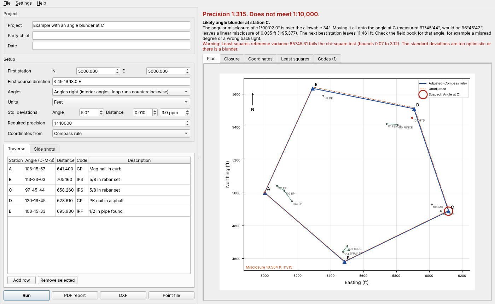

# Traverse Doctor

A Windows desktop app that checks a closed loop traverse the way a surveying course teaches it, finds the blunder when it won't close, and hands the result to CAD.

Type in or open a CSV of angles and distances (or a raw total station export with slope distances and zenith angles). Traverse Doctor balances the angles, computes latitudes, departures, linear misclosure and precision, adjusts by the compass rule, the transit rule and least squares, and computes the area. If the traverse doesn't close, it tells you which angle or distance is most likely wrong and what it probably should have been. Side shots and field codes become points, linework and layers in a DXF.

> Student-built tool for checking traverse computations. Not for boundary or construction work.



Sample reports: [site loop that closes](docs/sample-report-site-loop.pdf) and [loop with an angle blunder](docs/sample-report-angle-blunder.pdf).

## Download

Grab `TraverseDoctor.exe` from the latest [release](../../releases/latest) and double-click it. No install, no Python needed. Windows SmartScreen may warn because the exe is unsigned; choose "More info" then "Run anyway".

Every push to `main` also builds the exe as a GitHub Actions artifact.

## What it computes

| Step | How |
| --- | --- |
| Angular closure | Sum of angles against (n-2)180 (interior) or (n+2)180 (exterior); allowable 3σ√n; equal correction per angle |
| Azimuths and bearings | Carried from the given first course direction with balanced angles right or left, or entered per course |
| Latitudes and departures | L = d cos Az, D = d sin Az; linear misclosure, its direction, and precision 1:(perimeter / misclosure) |
| Compass (Bowditch) rule | Corrections proportional to course length |
| Transit rule | Corrections proportional to each latitude and departure |
| Least squares | Parametric adjustment of angles and distances, weights from σ angle and σ distance (constant + ppm), first station and first direction held; reference variance with chi-square test, residuals, standardized residuals (data snooping, flag at 3.29), local redundancy, standard error ellipses |
| Blunder finder | Angle: put the whole angular misclosure on each angle in turn and see which one makes the traverse close. Distance: find the course parallel to the misclosure and the length change that closes it. Only reported when one candidate clearly wins |
| Area | By coordinates, in sq ft and acres or m² and hectares |
| Side shots | Angle right from a backsight and a distance from any traverse station, located from the adjusted coordinates |
| Field codes | Library of common topo codes mapped to layers (EP, TBC, BLDG, FENCE, MH, FH, TREE, ...). `EP1`/`EP2` are separate strings; `B` begins a line, `E` ends it, `C` closes it. Unknown codes get a closest-match suggestion, or Claude's suggestion if an API key is set |

## Outputs

- **PDF closure report**: angle table, latitudes and departures, compass corrections, coordinates from all three adjustments, least squares statistics and residuals, blunder search table, plan view, point list, and a plain-English summary.
- **DXF** (R2010): adjusted loop, unadjusted loop (dashed, shows the misclosure), points with labels, and coded linework on their own layers, in ground coordinates.
- **Point file**: `Point,Northing,Easting,Elevation,Code,Description` CSV for CAD or a data collector.

## Input file

```
# start_n = 5000.00
# start_e = 5000.00
# start_direction = S 49 19 13 E   (course from the first station to the second)
# angles = right                   (right, left or azimuth)
# units = ft
# sigma_angle = 5
# sigma_distance = 0.01
# sigma_ppm = 3
# required_precision = 10000
Type,Station,From,BS,Angle,Distance,Code,Description
TRAV,A,,,106-15-57,641.40,CP,Mag nail in curb
TRAV,B,,,113-23-03,705.16,IPS,5/8 in rebar set
...
SS,101,A,E,35-10-20,85.42,EP1 B,Edge of pavement
```

Columns are matched by name: `Point`/`HA`/`HD`, or `SD` plus `ZA` for a raw export, work too. Interior angles are angles right on a counterclockwise loop and angles left on a clockwise one. Three examples are in [traverse_doctor/examples](traverse_doctor/examples) and under File > Open example.

## Verification

`tests/` (69 tests) checks the math against cases you can do by hand and against planted errors:

- A 200 x 100 ft rectangle with one side taped 0.30 ft long: latitudes, departures, precision 1:2001, and every compass and transit correction checked against the hand formulas
- 20" angular misclosure on four angles: 5" correction each, allowable 3 x 5" x √4
- Area by coordinates of a square and a 3-4-5 triangle
- Least squares on error-free data returns the exact coordinates with zero residuals (angles right and left); the solution minimizes the weighted sum of squared residuals (random perturbations always increase it); local redundancy numbers sum to the redundancy
- Blunder finder points to the right angle at every station for 1°, 30' and 10' errors, to the right course for 10 ft and 1 ft distance errors, and declines to blame either of two parallel courses
- CSV round trip, slope distance and zenith reduction, side shot geometry, field code linework, DXF layers and entities

```
pip install -r requirements.txt
python -m pytest
```

## Run from source

```
pip install -r requirements.txt
python -m traverse_doctor
```

## Build the exe yourself

```
pyinstaller packaging/traverse_doctor.spec --noconfirm
```

The exe lands in `dist/TraverseDoctor.exe`. The GitHub Actions workflow in `.github/workflows/build.yml` does the same on `windows-latest`, self-tests the exe, and attaches it to a release for any `v*` tag or when run by hand with a `release_tag`.

## Claude (optional)

Settings > Claude API key. The key is stored in `%APPDATA%\TraverseDoctor\settings.json`. With a key, Claude Haiku writes the report summary from a JSON of the computed numbers (it never computes anything) and can map unknown field codes onto the library. Without a key everything works offline with a template summary and spelling-based code suggestions.

## Layout

```
traverse_doctor/
  angles.py      DMS, bearings and azimuths
  model.py       inputs (TraverseInput, Station, Sideshot)
  traverse.py    angular closure, lat/dep, precision, compass and transit rules, area
  lsq.py         least squares adjustment and statistics
  blunders.py    angle and distance blunder finder
  codes.py       field code library, layers and linework
  engine.py      runs everything, side shot coordinates
  fileio.py      CSV in and out
  dxf.py         DXF output (ezdxf)
  plots.py       plan view (matplotlib)
  report.py      PDF report (ReportLab)
  narrative.py   Claude summary and code mapping with offline fallback
  ui/            PySide6 window
  examples/      example traverses
tests/           pytest suite
```
